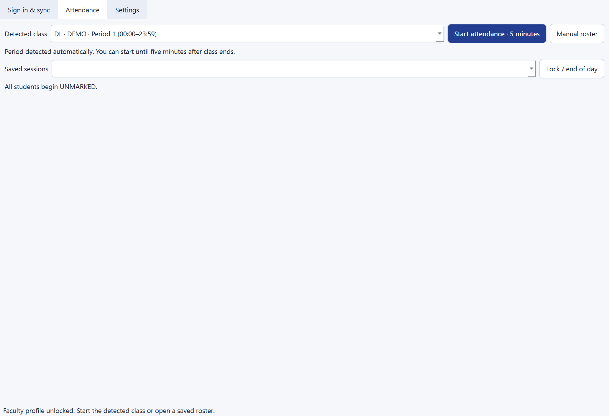

# AttendX V2

Offline-first, faculty-controlled attendance and face verification for a university prototype.
The central FastAPI/React portal manages identity and enrollment. A separate Windows faculty
application runs classroom verification, preserves attendance offline, and synchronizes only
explicitly approved results.

**Working prototype, with hardware validation still required.** The Windows executable builds,
starts, and loads the real SCRFD/AdaFace/MediaPipe pipeline on CUDA. Central approval and offline
recovery/synchronization are tested. Real-phone hotspot, certificate trust, camera/liveness,
and two QR scans have not yet been validated end to end. No real university system is connected.

The faculty app now detects the current class/period and uses one guided **Start attendance**
flow. It prepares the laptop hotspot/TLS automatically, shows full Wi-Fi and attendance QR
codes, and stops classroom networking after five minutes. Phones install the common AttendX
classroom trust profile once per deployment, rather than once for every faculty. The Windows
hotspot start/address-check/stop test passed; phone trust and real-person verification still need testing.



For the updated app, use the desktop **AttendX Faculty** shortcut and follow the
[five-step quick test](docs/v2/QUICK_START.md). Existing faculty profiles must reauthorize
online once to switch to the common classroom certificate.

## Attendance authority

Every academically assigned student appears, including students without approved biometrics.
Every attendance row begins **UNMARKED**. A roll number, face match, or QR submission cannot
finalize attendance. Faculty marks PRESENT/ABSENT, reviews exceptions, confirms physical
headcount, and explicitly approves a durable snapshot. Corrections become audited revisions.

```mermaid
flowchart LR
  A[Admin invitation] --> B[Student activation and three samples]
  B --> C[Assigned CC checks identity in person]
  C --> D[Admin final enrollment approval]
  D --> E[Faculty authorized encrypted roster cache]
  E --> F[Hotspot-only classroom verification and two QR stages]
  F --> G[Faculty review and manual decisions]
  G --> H[Headcount and explicit final approval]
  H --> I[Local durable outbox]
  I --> J[Central approved attendance]
```



## Included

- University-domain email invitations, single-use activation/reset tokens, Argon2id passwords,
  session revocation, and an encrypted SMTP delivery outbox with a local Mailpit catcher.
- Exactly three quality-checked, identity-consistent samples; encrypted templates; optional
  encrypted photo previews; consent withdrawal; scoped in-person CC review and admin approval.
- Configured semester dates, renewal versions, expiry/countdown, retention and email reminders.
- Teaching/CC assignments and full class rosters, including pending and unenrolled students.
- A separate DPAPI-protected Windows faculty cache; offline PIN unlock with expiring grants;
  editable rosters, consolidated reviews, headcount, approval and amendments.
- Five-second classroom QR epochs, distinct entry/finalization states, server-side active
  liveness and median-of-three reference comparison using the existing face pipeline.
- Transactional outbox, stable event IDs, content-bound acknowledgments, retry/backoff,
  immutable meeting metadata, idempotent central ingestion and conflict detection.
- PySide6 desktop, tray, timetable reminders, privacy locking, WinRT hotspot controls and
  a student HTTPS listener restricted to a verified hotspot adapter/subnet.
- Central views and CSV export containing **only approved attendance**. V1 absence derivation
  and approval-bypassing routes are disabled by default.

## Run

Read [operations](docs/v2/OPERATIONS.md) for exact startup/shutdown commands and certificate setup.
V2 uses its own Docker project, image, containers and volume; V1 remains on port 8470/HTTPS 8443.

```powershell
docker compose --env-file .env.v2 -f docker-compose.v2.yml up -d --build
docker compose --env-file .env.v2 -f docker-compose.v2.yml exec central attendx create-admin --username admin
# Enter your own administrator password at the prompt.
```

Set the central portal HTTPS URL in `.env.v2` for your deployment before sending invitations.
If you choose a public central URL, phones need no Tailscale for activation, enrollment, or
central sign-in. Classroom attendance intake remains faculty-hotspot-only. Mailpit is local at
[http://127.0.0.1:8026/](http://127.0.0.1:8026/); it captures messages and sends nothing externally.

Faculty executable: `dist/faculty/AttendXFaculty/AttendXFaculty.exe` (generated, not committed).
Distribute the **whole folder**, plus separately installed licensed model files. The CUDA build
is approximately 4.8 GB; it is not a single standalone 48 MB application.

```powershell
.\dist\faculty\AttendXFaculty\AttendXFaculty.exe --models-dir .\models
```

Set the central HTTPS URL in the faculty sign-in tab. Provision online once, choosing a local
faculty PIN/passphrase. Students never sign in to the faculty application or classroom website.

## Verify

```powershell
cd backend
.venv\Scripts\python.exe -m pytest -q
cd ..\frontend
npm test
npm run build
cd ..
backend\.venv\Scripts\python.exe scripts\verify_offline_demo.py
backend\.venv\Scripts\python.exe scripts\build_faculty.py
```

The HTTPS offline demo starts an isolated synthetic central process, stops it, approves
attendance in a separate faculty process, restarts the faculty process, restores central,
and verifies upload plus duplicate retries. It touches no deployed databases or services.
Most face-flow tests use deterministic synthetic observations; these are not accuracy results.

## Documentation

| Document | Contents |
|---|---|
| [Handover](docs/v2/HANDOVER.md) | Feature status, evidence, limitations and blockers |
| [Operations](docs/v2/OPERATIONS.md) | Startup, shutdown, desktop build, models, real-phone procedure |
| [API](docs/v2/API.md) | Auth, enrollment, sync and classroom contracts |
| [OpenAPI](docs/v2/openapi.json) | Generated central V2 interface; live full schema at `/api/openapi.json` |
| [Implementation ledger](docs/v2/IMPLEMENTATION.md) | Baseline, milestones and engineering decisions |
| [Definitive requirements](docs/v2/REQUIREMENTS.md) | Original accepted specification |
| [Historical V1 README](docs/v1/README.md) | Previous architecture/workflow; not the V2 attendance policy |
| [Thresholds](docs/thresholds.md) | Provisional thresholds and validation methodology |
| [Third-party notices](THIRD_PARTY_NOTICES.md) | Model and library terms |

Active liveness does not guarantee resistance to video replay, virtual cameras or deepfakes.
QR/hotspot access does not guarantee physical presence. Three-reference thresholds need
validation on consenting deployment participants; no real-population accuracy is claimed.
Model weights restrict this configuration to **non-commercial academic use**.

## Copyright

Copyright © 2026 Azeem. All rights reserved. See [LICENSE](LICENSE) for the original AttendX
code and documentation and [third-party notices](THIRD_PARTY_NOTICES.md) for separate terms.
